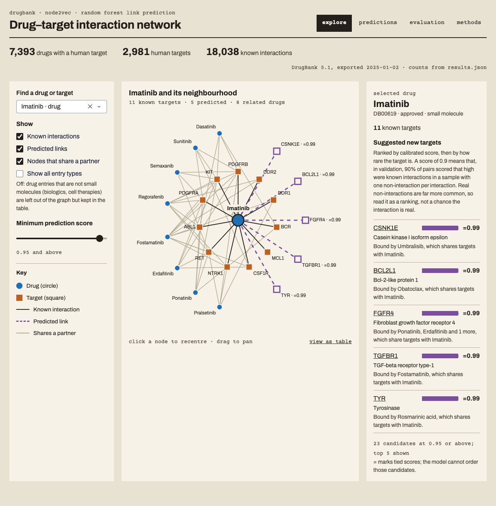
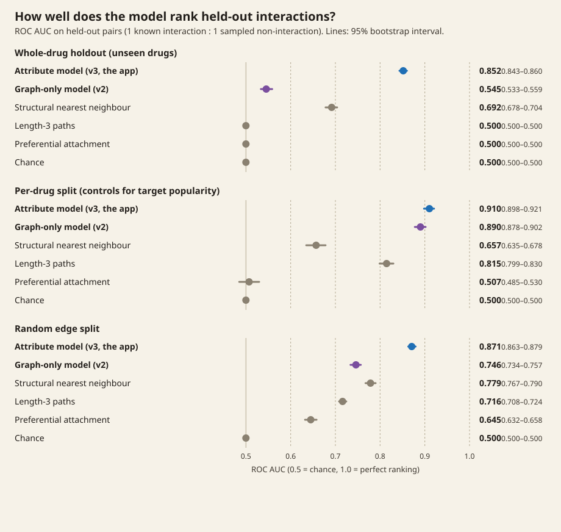

# Drug–target interaction network



A Dash app and pipeline that turn a DrugBank export into a drug–target network, learn which unrecorded drug–target pairs look like real interactions, and show the evidence for each suggestion. Drugs and human protein targets form a bipartite graph; Node2Vec embeds it; a random forest scores pairs from graph and embedding features. The app has four views: **explore** (search a drug or target, see its neighbourhood and ranked suggestions), **predictions**, **evaluation** and **methods**.

## Run it

You need a DrugBank full-database export (`drugbank_all_full_database.xml.zip`). DrugBank gives it free to academic users under its own licence; it is not in this repository and nothing derived from it is committed.

```bash
export DRUGBANK_PATH=~/Documents/drugbank/drugbank_all_full_database.xml.zip   # the default
make run        # creates .venv, parses, trains, scores, then serves http://127.0.0.1:8050
```

`make run` runs only the steps whose outputs are missing:

| Step | Command | Output (gitignored unless noted) |
|---|---|---|
| Parse DrugBank (streams the zip) | `python src/datasources/drugbank_loader.py` | `data_raw/*.parquet` |
| Train and evaluate | `python train_ml_models.py` | `models/`, `data/`, `results/results.json` (committed) |
| Score suggestions | `python predict_links.py` | `models/predictions.parquet` |
| Serve | `python app.py` | |

Tests use synthetic data only: `make test`. Python 3.11; versions are pinned in `requirements.txt`.

## Results



<!-- results:start -->
DrugBank 5.1 (exported 2025-01-02): 7,393 drugs with a human target, 2,981 human targets, 18,038 interactions. Run 2026-10-12, commit `ab9d58a`, seed 42.

ROC AUC and average precision on held-out pairs (one sampled non-interaction per known interaction), with 95% bootstrap intervals over test pairs:

| Method | Random split ROC AUC | Random split AP | Per-drug split ROC AUC | Per-drug split AP |
|---|---|---|---|---|
| Random forest, degree-matched negatives (app) | 0.746 (0.734–0.757) | 0.771 (0.756–0.786) | 0.890 (0.878–0.902) | 0.907 (0.893–0.919) |
| Random forest, uniform negatives | 0.895 (0.888–0.902) | 0.901 (0.892–0.910) | 0.785 (0.766–0.802) | 0.779 (0.753–0.802) |
| Length-3 paths | 0.716 (0.708–0.724) | 0.718 (0.708–0.728) | 0.821 (0.805–0.835) | 0.801 (0.777–0.823) |
| Preferential attachment | 0.640 (0.627–0.653) | 0.731 (0.719–0.744) | 0.502 (0.480–0.525) | 0.504 (0.478–0.531) |
| Chance | 0.500 (0.500–0.500) | 0.500 (0.489–0.512) | 0.500 (0.500–0.500) | 0.500 (0.481–0.519) |

The app's model uses degree-matched training negatives, chosen on the per-drug split's validation drugs before any test pair was scored (validation ROC AUC 0.854 vs 0.757).

Default suggestion threshold 0.95: the lowest of 0.50, 0.60, 0.70, 0.80, 0.90, 0.95 that leaves the median featured drug with at most 10 candidates. Median candidates at or above each score: 0.50: 209.5, 0.60: 108, 0.70: 48, 0.80: 29, 0.90: 22, 0.95: 7.

Produced by `python src/datasources/drugbank_loader.py` then `python train_ml_models.py` then `python predict_links.py`; table and figure by `python scripts/make_figures.py`.
<!-- results:end -->

**Two splits.** The *random edge split* hides 20% of known interactions at random (another 20% train the classifier, 60% stay as the graph the features are computed on) and samples uniform random non-interactions. The *per-drug split (controls for target popularity)* hides half the interactions of 20% of drugs with two or more targets and pairs each with a non-interaction for the same drug and a target of similar degree. A quarter of each split's training interactions is held back for validation; choices are made there and each test set is scored once.

**Two models.** The forests differ only in their training negatives. Each wins on the split whose test negatives match its training: uniform negatives reward preferring popular targets, which is what separates uniform random non-interactions from real ones. The app uses the degree-matched model because its job is ranking targets for one drug, where popularity alone is not evidence.

**Baselines.** Length-3 paths counts drug → target′ → drug′ → target routes; preferential attachment multiplies degrees; chance ties every pair. Common neighbours is not shown: a drug and a target never share a neighbour in a bipartite graph, so it scores every pair 0.

An earlier version of this README reported ROC AUC 0.93 on a "temporal" split. That figure came from code that leaked held-out edges into training features and could not be reproduced; the split was random, not temporal.

## Limitations

- **No unseen drugs.** Node2Vec only embeds nodes with edges, so a drug with no known targets cannot be scored. Neither split tests brand-new compounds.
- **Not temporal.** DrugBank has no per-interaction dates, so the evaluation cannot say how well the model anticipates future discoveries.
- **Negatives are unmeasured.** Sampled non-interactions include real interactions nobody has tested; balanced 1:1 test sets make precision look far better than it would in screening.
- **Scores are rankings.** Suggestion scores are calibrated with isotonic regression on validation pairs, but on balanced data; they are not the chance an interaction is real. Isotonic calibration is a step function, so many top scores tie; the app marks ties and orders them by target rarity.
- **Intervals** cover resampling of test pairs only, not other split seeds or DrugBank releases.
- **DrugBank entries** include ions, salts, supplements and cell therapies. The app features approved small molecules only and hides other entry types from the graph by default.

## Licence

Code: MIT (see `LICENSE`). DrugBank data is licensed separately by DrugBank (CC BY-NC 4.0 for the full database) and is not included. Fonts: Archivo and Courier Prime, SIL Open Font License (`assets/fonts/`).
