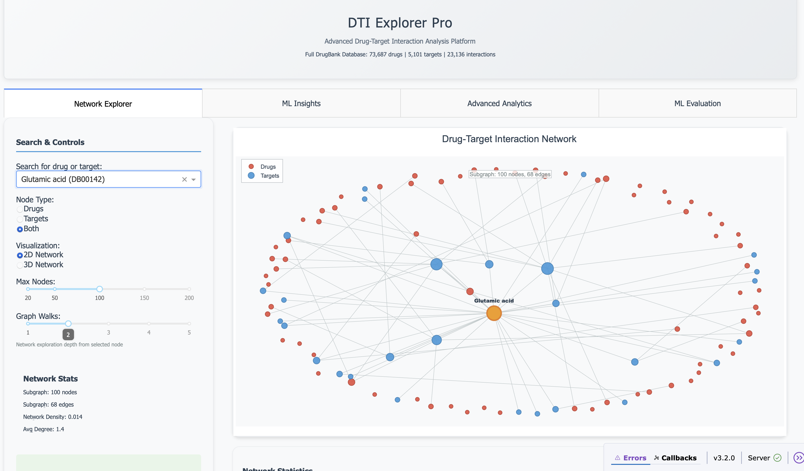
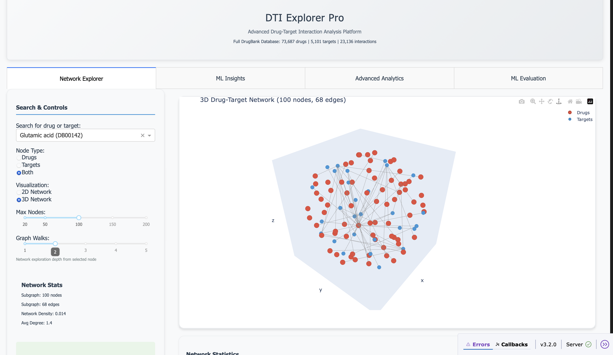
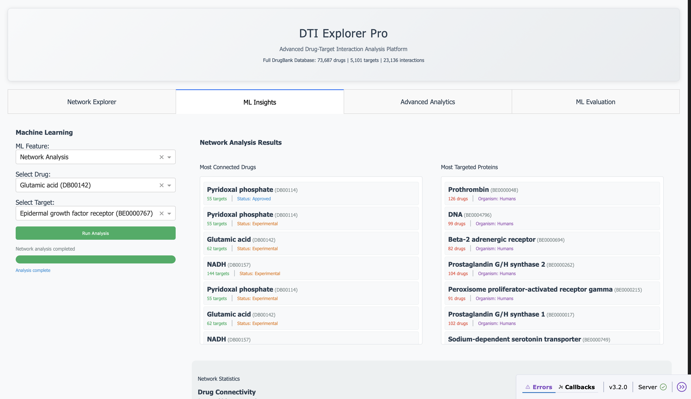
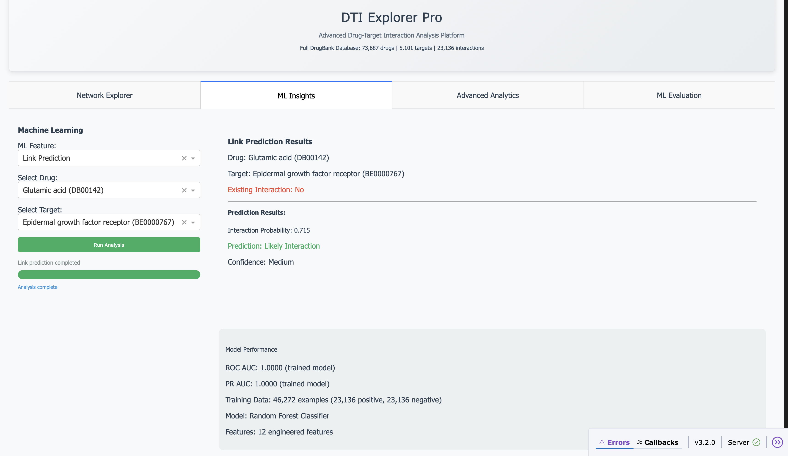
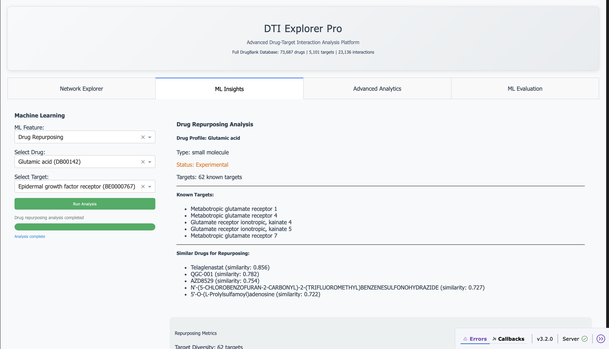
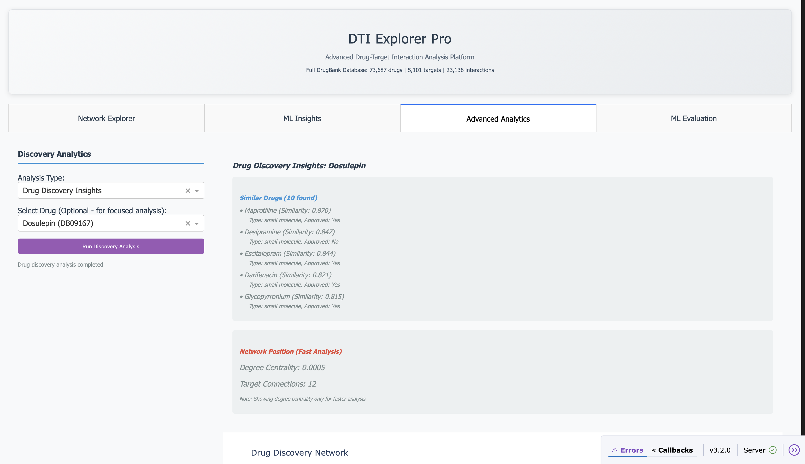
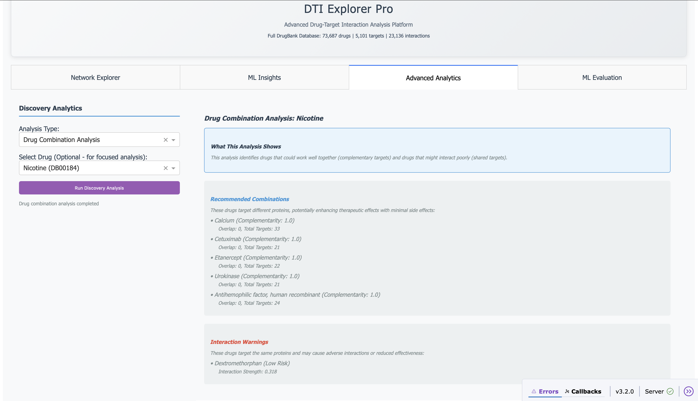
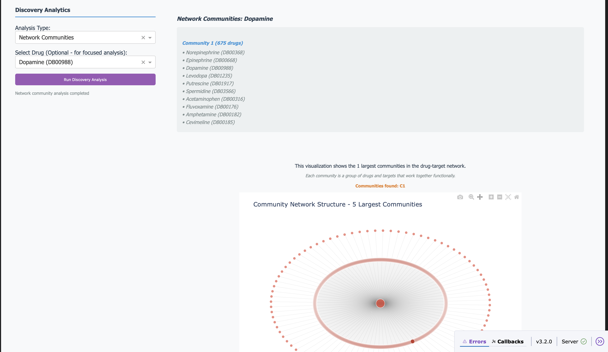
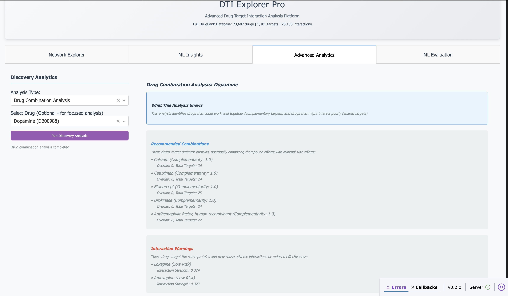
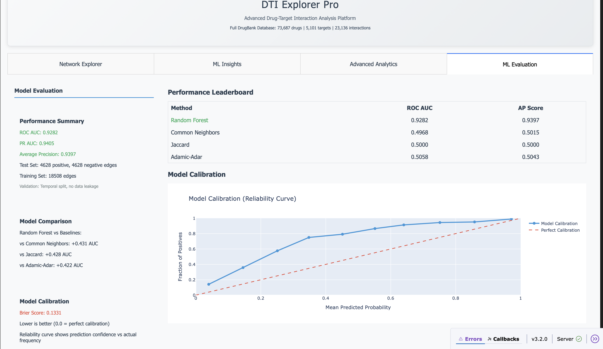

# Drug-Target Interaction Explorer Pro

A comprehensive web application for analyzing drug-target interactions using network science and machine learning. This tool provides advanced visualization, similarity analysis, link prediction, and drug discovery insights.

## 🖼️ Application Screenshots

### Network Visualization

*Interactive 2D network graph showing drug-target interactions with hover details and node selection*


*Three-dimensional network visualization for enhanced spatial exploration of drug-target relationships*

### Network Analysis

*Comprehensive network statistics and metrics panel showing graph properties and node information*

### Link Prediction

*Machine learning-powered drug-target interaction prediction with confidence scores and model performance*

### Drug Repurposing

*Drug repurposing analysis showing similar drugs and repurposing opportunities based on embeddings*


*Detailed drug repurposing results with similarity scores and target information*

### Advanced Analytics

*Drug combination analytics identifying synergistic drug pairs and interaction warnings*


*Network community detection showing functional groups of drugs and targets*


*Comprehensive drug combination recommendations with complementarity scores*

### ML Evaluation

*Machine learning model evaluation with performance metrics, calibration plots, and baseline comparisons*

---

## 🚀 Features

### **Network Visualization**
- **2D/3D Interactive Graphs** - Explore drug-target networks with Plotly
- **Smart Node Sampling** - Handle large networks efficiently
- **Graph Walks** - Control exploration depth (1-5 hops)
- **Real-time Statistics** - Network metrics and node details

### **Similarity Analysis**
- **Drug Similarity** - Find similar drugs using embeddings
- **Target Similarity** - Identify related protein targets
- **Configurable Results** - 5-20 similar entities
- **Cosine Similarity** - Advanced similarity scoring

### **Link Prediction**
- **ML-Powered Predictions** - Predict new drug-target interactions
- **Probability Scores** - Confidence levels for predictions
- **Temporal Validation** - Prevents data leakage
- **Baseline Comparisons** - Common Neighbors, Jaccard, Adamic-Adar

### **Advanced Analytics**
- **Drug Discovery Insights** - Similar drugs and repurposing opportunities
- **Network Communities** - Community detection and visualization
- **Drug Combinations** - Identify synergistic drug pairs
- **Interaction Warnings** - Potential drug-drug interactions

### **ML Evaluation**
- **Comprehensive Metrics** - ROC-AUC, PR-AUC, Average Precision
- **Calibration Plots** - Model reliability assessment
- **Confidence Intervals** - Statistical significance
- **Performance Baselines** - Compare against heuristic methods

## 📊 Data

### **DrugBank Integration**
- **73,687 Drugs** - Complete DrugBank database
- **5,101 Targets** - Protein targets and enzymes
- **23,136 Interactions** - Known drug-target relationships
- **Full Licensing Compliance** - Users provide their own DrugBank export

### **Data Sources**
- **Primary**: DrugBank XML export (user-provided)
- **Format**: Parquet files for fast loading
- **Graph**: NetworkX with all entities
- **Embeddings**: Node2Vec for similarity analysis

## 🛠 Installation

### **Prerequisites**
```bash
# Python 3.10+ required
python --version

# Install dependencies
pip install -r requirements.txt
```

### **Data Setup**
1. **Obtain DrugBank License**: Get access to DrugBank database
2. **Download DrugBank**: Export full database as XML
3. **Run Pipeline**: Process data into required formats

```bash
# Process DrugBank data
python -m src.datasources.drugbank_loader

# Build network graph
python -m src.pipeline.build_graph

# Generate embeddings
python -m src.pipeline.embeddings

# Train ML models
python train_ml_models.py
```

### **Launch Application**
```bash
# Start the web application
python app.py

# Access at: http://localhost:8050
```

## 🏗 Architecture

### **Modular Structure**
```
dti-graph/
├── app.py                    # Main application (2606 lines)
├── app_modular.py           # Modular version (in development)
├── src/
│   ├── app/
│   │   ├── layout.py        # Layout components
│   │   └── callbacks.py     # Callback functions
│   ├── pipeline/
│   │   ├── advanced_analytics.py
│   │   ├── link_prediction.py
│   │   ├── drug_repurposing.py
│   │   └── embeddings.py
│   ├── datasources/
│   │   └── drugbank_loader.py
│   └── config.py
├── data/                    # Processed data files
├── data_raw/                # Raw data files
├── models/                  # Trained ML models
└── tests/                   # Test files

### **Key Components**
- **Dash/Plotly**: Web framework and visualization
- **NetworkX**: Graph operations and analysis
- **Scikit-learn**: Machine learning models
- **Node2Vec**: Graph embeddings
- **Pandas**: Data manipulation

## 🔬 Usage

### **Network Exploration**
1. **Select Tab**: "Network Visualization"
2. **Search**: Find drugs or targets by name
3. **Explore**: Use graph walks to expand network
4. **Analyze**: View network statistics and metrics

### **Similarity Analysis**
1. **Select Tab**: "Similarity Analysis"
2. **Choose Drug**: Select a drug of interest
3. **Set Parameters**: Choose similarity type and count
4. **Find Similar**: Discover related compounds

### **Link Prediction**
1. **Select Tab**: "Link Prediction"
2. **Choose Pair**: Select drug and target
3. **Predict**: Get interaction probability
4. **Evaluate**: View model confidence

### **Advanced Analytics**
1. **Select Tab**: "Advanced Analytics"
2. **Choose Analysis**: Discovery, Communities, or Combinations
3. **Run Analysis**: Execute computational analysis
4. **Explore Results**: Interactive visualizations

## 📈 Performance

### **Optimizations**
- **Lazy Loading**: Data loaded only when needed
- **Subset Processing**: Efficient analytics on large datasets
- **Caching**: Memoized expensive calculations
- **Background Processing**: Non-blocking analytics

### **Scalability**
- **Large Networks**: Handle 70K+ drugs and 5K+ targets
- **Smart Sampling**: Efficient visualization of large graphs
- **Memory Management**: Optimized for large datasets
- **Parallel Processing**: Multi-threaded analytics

## 🔒 Licensing

### **DrugBank Data**
- **User Responsibility**: Users must provide their own DrugBank export
- **No Bundled Data**: Application does not include DrugBank data
- **License Compliance**: Respects DrugBank licensing terms
- **Data Processing**: Only processes user-provided data

### **Application Code**
- **Open Source**: MIT License for application code
- **Academic Use**: Suitable for research and education
- **Commercial Use**: Check licensing requirements

## 🧪 Testing

### **Run Tests**
```bash
# Run all tests
pytest tests/

# Run specific test
pytest tests/test_graph.py

# Run with coverage
pytest --cov=src tests/
```

### **Test Coverage**
- **Data Loading**: DrugBank parser tests
- **Graph Operations**: Network analysis tests
- **ML Models**: Link prediction tests
- **Web Interface**: Dash callback tests

## 🐛 Troubleshooting

### **Common Issues**

**Data Loading Errors**
```bash
# Check data files exist
ls data_raw/
ls data/

# Re-run pipeline
python -m src.datasources.drugbank_loader
```

**ML Model Errors**
```bash
# Train models
python train_ml_models.py

# Check model files
ls models/
```

**Memory Issues**
```bash
# Reduce max nodes in visualization
# Use subset processing for analytics
# Monitor system resources
```

### **Performance Tips**
- **Use SSD**: Faster data loading
- **Increase RAM**: Better for large datasets
- **Limit Visualization**: Reduce max nodes for large networks
- **Background Processing**: Run heavy analytics in background

## 🤝 Contributing

### **Development Setup**
```bash
# Clone repository
git clone <repository-url>
cd dti-graph

# Install development dependencies
pip install -r requirements.txt
pip install pytest ruff

# Run linting
ruff check src/

# Run tests
pytest tests/
```

### **Code Style**
- **Python**: PEP 8 compliance
- **Documentation**: Docstrings for all functions
- **Type Hints**: Type annotations where possible
- **Testing**: Unit tests for new features

## 📚 Documentation

### **Additional Resources**
- **tests/**: Test examples and validation

### **Development Notes**

#### **Modular Architecture**
The application has been restructured into a modular architecture for better organization:
- **`app.py`**: Main monolithic application (2606 lines, fully functional)
- **`app_modular.py`**: Modular version (in development)
- **`src/app/layout.py`**: Layout components
- **`src/app/callbacks.py`**: Callback functions

**Benefits**: Separation of concerns, maintainability, reusability, testing, readability

#### **Codebase Cleanup**
Recent cleanup efforts have:
- **Removed 1.7GB** of duplicate and unnecessary files
- **Reduced directory size** from 1.9GB to 195MB (90% reduction)
- **Eliminated duplicates**: Data files, loaders, cache directories
- **Updated .gitignore**: Comprehensive patterns for all data files

**Current Status**: Clean, organized structure with no redundant files

### **API Reference**
- **Layout Components**: `src/app/layout.py`
- **Callback Functions**: `src/app/callbacks.py`
- **Analytics**: `src/pipeline/advanced_analytics.py`
- **Data Loading**: `src/datasources/drugbank_loader.py`

## 📄 License

This project is licensed under the MIT License - see the LICENSE file for details.

**Note**: DrugBank data is not included and users must provide their own licensed data export.

---

**Drug-Target Interaction Explorer Pro** - Advanced network analysis and machine learning for drug discovery 🚀
